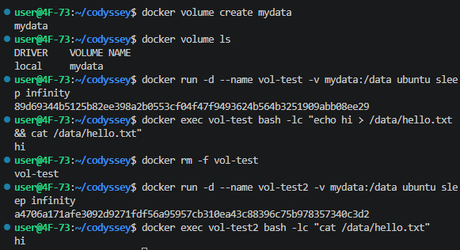
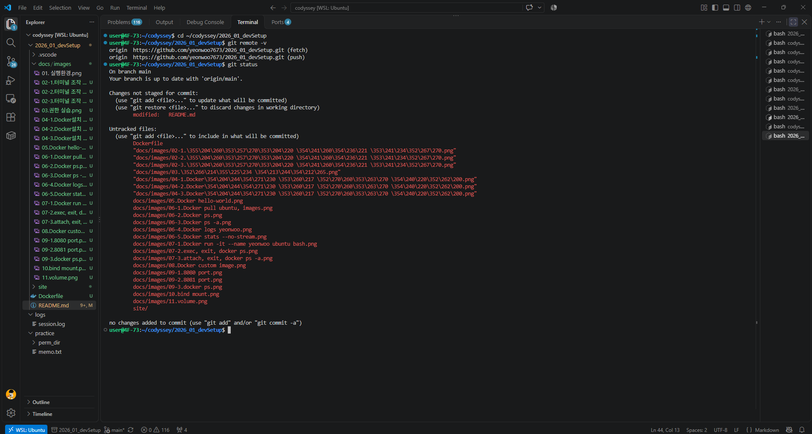

<<<<<<< HEAD
# 2026_01_devSetup
미션 01. 내 컴퓨터에 개발자용 '작업실' 꾸미기

## 1. 프로젝트 개요
- 코드를 작성하기 전에 개발 환경을 세팅하고, 누구나 같은 방식으로 실행할 수 있는 워크스테이션을 구축한다.
- **CLI(터미널)**: 작업 디렉토리 구성, 파일/디렉토리 권한 설정
- **Docker**: 이미지/컨테이너 실행·관리, 로그·리소스 점검
- **Dockerfile**: 웹 서버 컨테이너화 → 포트 매핑 접속 확인 → 바인드 마운트(변경 반영) / 볼륨(데이터 영속성) 검증
- **Git/GitHub**: 로컬 버전관리 설정 + VSCode에서 GitHub 저장소 연동

## 2. 실행 환경
| 항목 | 값 |
|---|---|
| Host OS | Windows (공용 PC) |
| Linux | WSL2 + Ubuntu 26.04.1 LTS |
| Shell / 터미널 | bash / VSCode 통합 터미널 (WSL 확장) |
| Docker | Docker Desktop, Engine 29.9.3 (WSL Integration) |
| Git | 2.53.0 |

```bash
user@4F-73:~/codyssey$ cat /etc/os-release | head -3
PRETTY_NAME="Ubuntu 26.04.1 LTS"
NAME="Ubuntu"
VERSION_ID="26.04"
```


### 2-1. 디렉토리 구조
```
2026_01_devSetup/                # 프로젝트 루트 (GitHub 저장소)
├── .vscode/
│   └── settings.json            # VS Code 작업공간 설정
├── docs/
│   └── images/                  # README 증거 스크린샷 (01~12번, 섹션 번호 순)
├── site/
│   └── index.html               # NGINX가 서빙할 정적 페이지 (빌드 시 이미지로 복사 / 바인드 마운트 대상)
├── Dockerfile                   # nginx:alpine 기반 커스텀 이미지 정의
└── README.md                    # 수행 기록: 명령·결과·개념 정리·트러블슈팅
```


**구성 기준**
- **실행에 필요한 것**(`Dockerfile`, `site/`)과 **기록·증거**(`README.md`, `docs/`)를 분리했다.
- `Dockerfile`을 루트에 둬서, 루트에서 `docker build -t my-web:1.0 .` 한 줄로 빌드된다. `COPY site/`가 루트 기준 상대 경로라서 빌드 컨텍스트가 루트여야 한다.
- 스크린샷 파일명 앞 번호는 README 섹션 순서와 맞춰서, 증거를 바로 찾을 수 있게 했다.
- 리눅스 파일·권한 실습(`practice/`)은 결과물이 아니라 연습용이라 저장소 바깥(WSL `~/codyssey/practice`)에서 진행했고, 저장소에는 포함하지 않았다.

### 2-2. 재현 절차 (요약)
> 모든 명령은 **프로젝트 루트**(`2026_01_devSetup/`)에서 실행하는 것을 기준으로 한다. `docker build .`와 `-v "$(pwd)/site"`가 현재 위치를 기준으로 동작하기 때문이다. ([트러블슈팅 5)](#5-바인드-마운트-시-403-forbidden--permission-denied) 참고)

```bash
git clone https://github.com/yeonwoo7673/2026_01_devSetup.git
cd 2026_01_devSetup
docker build -t my-web:1.0 .                                      # ① 빌드
docker run -d -p 8080:80 --name my-web-8080 my-web:1.0            # ② 실행 (호스트 8080 → 컨테이너 80)
curl http://localhost:8080                                        # ③ 확인
docker rm -f my-web-8080                                          # ④ 정리
```
- 접속이 안 되면 [17. 포트 충돌 진단 절차](#17-포트-충돌-진단-절차)를 따른다.

> ⚠️ 재현 시 주의
> - 공용 PC라 관리자 권한이 없어 WSL2 + Docker Desktop(사용자별 설치)으로 구성. ([15. 트러블슈팅](#15-트러블슈팅) 참고)
> - 실습은 WSL의 리눅스 홈(`~`)에서 진행했다. `/mnt/c/...`(Windows 디스크)에서는 `chmod`가 제대로 반영되지 않을 수 있음.
> - Linux/macOS에서는 Docker Engine만 설치하면 같은 명령으로 재현 가능.
> - Windows(PowerShell)에서 직접 실행할 때는 `$(pwd)` 대신 `${PWD}`를 쓴다. 바인드 마운트 경로는 WSL 쪽 경로를 쓰는 편이 권한 문제가 적다.

## 3. 수행 체크리스트
- [x] 터미널 기본 조작 및 폴더 구성
- [x] 권한 변경 실습 (파일 1개 + 디렉토리 1개)
- [x] Docker 설치/점검 (`--version`, `info`)
- [x] Docker 기본 운영 명령 (`images`, `ps`, `ps -a`, `logs`, `stats`)
- [x] hello-world 실행
- [x] ubuntu 컨테이너 진입 + attach/exec 차이 정리
- [x] Dockerfile 커스텀 이미지 빌드/실행
- [x] 포트 매핑 접속 (2회: 8080, 8081)
- [x] 바인드 마운트 반영
- [x] 볼륨 영속성
- [x] Git 설정 + VSCode GitHub 연동
- [x] 포트 충돌 진단 절차 정리
- [x] 볼륨 백업·복구

## 4. 검증 방법 및 증거
| 항목 | 검증 명령 | 확인 내용 | 증거 위치 |
|---|---|---|---|
| 실행 환경 | `cat /etc/os-release`, `docker --version`, `git --version` | OS·Docker·Git 버전 출력 | [2. 실행 환경](#2-실행-환경), [캡처1](docs/images/01.%20실행환경.png), [디렉토리 구조](docs/images/01-2.디렉토리%20구조.png) |
| 터미널 조작 | `pwd`, `ls -la`, `mkdir`, `cd`, `touch`, `echo >`, `cat`, `cp`, `mv`, `rm` | 생성·복사·이동·이름 변경·삭제 후 `ls -la`로 반영 확인 | [5. 터미널 조작 로그](#5-터미널-조작-로그), [캡처2](docs/images/02-1.터미널%20조작%20로그.png), [캡처3](docs/images/02-2.터미널%20조작%20로그.png), [캡처4](docs/images/02-3.터미널%20조작%20로그.png) |
| 권한 (파일) | `ls -l` → `chmod 755` → `ls -l` | `-rw-r--r--`(644) → `-rwxr-xr-x`(755) | [6. 권한 실습](#6-권한-실습), [캡처5](docs/images/03.권한%20실습.png) |
| 권한 (디렉토리) | `ls -ld` → `chmod 700` → `ls -ld` | `drwxr-xr-x`(755) → `drwx------`(700) | [6. 권한 실습](#6-권한-실습), [캡처5](docs/images/03.권한%20실습.png) |
| Docker 설치 | `docker --version` | `Docker version 29.9.3` 출력 | [7. Docker 점검](#7-docker-설치-및-기본-점검), [캡처6](docs/images/04-1.Docker설치%20및%20기본%20점검.png) |
| 데몬 동작 | `docker info` | Server 섹션 출력 (`Server Version: 29.9.3`, `OSType: linux`) | [7. Docker 점검](#7-docker-설치-및-기본-점검), [캡처7](docs/images/04-2.Docker설치%20및%20기본%20점검.png), [캡처8](docs/images/04-3.Docker설치%20및%20기본%20점검.png) |
| hello-world | `docker run hello-world` | `Hello from Docker!` 출력 | [8. 운영 명령](#8-docker-기본-운영-명령), [캡처9](docs/images/05.Docker%20hello-world.png) |
| 이미지 관리 | `docker pull ubuntu`, `docker images` | `hello-world`, `ubuntu` 이미지 목록 | [8. 운영 명령](#8-docker-기본-운영-명령), [캡처10](docs/images/06-1.Docker%20pull%20ubuntu,%20images.png) |
| 컨테이너 상태 | `docker ps`, `docker ps -a` | 실행 중(Up) / 종료(Exited) 구분 | [8. 운영 명령](#8-docker-기본-운영-명령), [캡처11](docs/images/06-2.Docker%20ps.png), [캡처12](docs/images/06-3.Docker%20ps%20-a.png) |
| 로그 확인 | `docker logs yeonwoo` | 컨테이너 터미널 출력 기록 | [8. 운영 명령](#8-docker-기본-운영-명령), [캡처13](docs/images/06-4.Docker%20logs%20yeonwoo.png) |
| 리소스 확인 | `docker stats --no-stream` | 컨테이너별 CPU·메모리 사용량 | [8. 운영 명령](#8-docker-기본-운영-명령), [캡처14](docs/images/06-5.Docker%20stats%20--no-stream.png) |
| ubuntu 컨테이너 | `docker run -it --name yeonwoo ubuntu bash` → `ls`, `echo` | 컨테이너 내부 명령 실행 결과 | [9. 컨테이너 실습](#9-컨테이너-실행-실습-ubuntu), [캡처15](docs/images/07-1.Docker%20run%20-it%20--name%20yeonwoo%20ubuntu%20bash.png) |
| attach vs exec | `exec` → `exit` → `docker ps` / `attach` → `exit` → `docker ps -a` | exec 종료 후 Up 유지, attach 종료 후 Exited | [9. 컨테이너 실습](#9-컨테이너-실행-실습-ubuntu), [캡처16](docs/images/07-2.exec,%20exit,%20docker%20ps.png), [캡처17](docs/images/07-3.attach,%20exit,%20docker%20ps%20-a.png) |
| 커스텀 이미지 | `docker build -t my-web:1.0 .`, `docker images` | `my-web:1.0` 이미지 생성 | [10. Dockerfile](#10-dockerfile-커스텀-이미지), [캡처18](docs/images/08.Docker%20custom%20image.png) |
| 포트 매핑 | `curl localhost:8080`, `curl localhost:8081`, 브라우저 접속 | 두 포트 모두 같은 페이지 응답 | [11. 포트 매핑](#11-포트-매핑-접속), [8080 캡처](docs/images/09-1.8080%20port.png), [8081 캡처](docs/images/09-2.8081%20port.png), [docker ps](docs/images/09-3.docker%20ps.png) |
| 바인드 마운트 | 호스트 `site/index.html` 수정 전·후 `curl` | 재빌드 없이 변경 반영 | [12. 바인드 마운트](#12-바인드-마운트-반영), [캡처19](docs/images/10.bind%20mount.png) |
| 볼륨 영속성 | 컨테이너 삭제 후 새 컨테이너에서 `cat /data/hello.txt`, `docker volume inspect mydata` | 삭제 후에도 데이터 유지, 저장 위치(Mountpoint) 확인 | [13. 볼륨](#13-볼륨-영속성), [캡처20](docs/images/11.volume.png) |
| Git 설정 | `git config --list` | `user.name`, `user.email`(마스킹), `init.defaultbranch=main` | [14. Git](#14-git-설정-및-github-연동) |
| GitHub 연동 | `git remote -v`, `git push origin main`, VSCode 계정 | push 성공(`main -> main`), VSCode GitHub 로그인 | [14. Git](#14-git-설정-및-github-연동), [VSCode 캡처](docs/images/12-1.vscode-gitHub.png), [git remote -v, git status](docs/images/12-2.git%20remote%20-v,%20git%20status.png), [git add, commit, push origin main](docs/images/12-3.git%20add,%20commit,%20push%20origin%20main.png) |
| 포트 충돌 진단 | `docker ps --filter publish=8080`, `ss -ltnp`, `netstat -ano` | 포트 점유 주체 확인 → 정리 후 재접속 | [17. 포트 충돌](#17-포트-충돌-진단-절차) |
| 볼륨 백업·복구 | `tar czf` 백업 → 새 볼륨에 `tar xzf` 복구 | 복구한 볼륨에서 `hello.txt` 확인 | [18. 백업](#18-볼륨-백업복구) |

## 5. 터미널 조작 로그
```bash
user@4F-73:~/codyssey$ pwd
/home/user/codyssey
user@4F-73:~/codyssey$ ls -la
total 16
drwxr-xr-x 4 user user 4096 Nov 23 19:44 .
drwxr-x--- 8 user user 4096 Nov 23 15:57 ..
drwxr-xr-x 5 user user 4096 Nov 23 19:49 2026_01_devSetup
drwxr-xr-x 2 user user 4096 Nov 23 19:29 logs
user@4F-73:~/codyssey$ mkdir -p practice/sub
user@4F-73:~/codyssey$ cd practice
user@4F-73:~/codyssey/practice$ touch empty.txt
user@4F-73:~/codyssey/practice$ echo "hello world" > memo.txt
user@4F-73:~/codyssey/practice$ cat memo.txt
hello world
user@4F-73:~/codyssey/practice$ cp memo.txt memo_copy.txt
user@4F-73:~/codyssey/practice$ mv memo_copy.txt sub/
user@4F-73:~/codyssey/practice$ mv sub/memo_copy.txt sub/renamed.txt
user@4F-73:~/codyssey/practice$ ls -la sub
total 12
drwxr-xr-x 2 user user 4096 Nov 23 19:52 .
drwxr-xr-x 3 user user 4096 Nov 23 19:52 ..
-rw-r--r-- 1 user user   12 Nov 23 19:51 renamed.txt
user@4F-73:~/codyssey/practice$ rm empty.txt
user@4F-73:~/codyssey/practice$ rm -r sub
user@4F-73:~/codyssey/practice$ ls -la
total 12
drwxr-xr-x 2 user user 4096 Nov 23 19:53 .
drwxr-xr-x 5 user user 4096 Nov 23 19:50 ..
-rw-r--r-- 1 user user   12 Nov 23 19:51 memo.txt
```

| 수행 항목 | 사용 명령 |
|---|---|
| 현재 위치 확인 | `pwd` |
| 목록 확인 (숨김 파일 포함) | `ls -la` |
| 생성 / 이동 | `mkdir -p`, `cd` |
| 빈 파일 생성 / 내용 확인 | `touch`, `cat` |
| 복사 / 이동·이름 변경 / 삭제 | `cp`, `mv`, `rm`, `rm -r` |

- 위 로그는 생략 없이 명령과 결과를 실행 순서대로 모은 것이다. 생성(`mkdir`, `touch`, `echo >`) → 복사·이동(`cp`, `mv`) → 삭제(`rm`) 결과를 마지막 `ls -la`에서 한 번에 확인할 수 있다.

## 6. 권한 실습
```bash
# 파일: 644 → 755
user@4F-73:~/codyssey/practice$ ls -l memo.txt
-rw-r--r-- 1 user user 12 Nov 23 19:51 memo.txt
user@4F-73:~/codyssey/practice$ chmod 755 memo.txt
user@4F-73:~/codyssey/practice$ ls -l memo.txt
-rwxr-xr-x 1 user user 12 Nov 23 19:51 memo.txt

# 디렉토리: 755 → 700
user@4F-73:~/codyssey/practice$ mkdir perm_dir
user@4F-73:~/codyssey/practice$ ls -ld perm_dir
drwxr-xr-x 2 user user 4096 Nov 23 19:56 perm_dir
user@4F-73:~/codyssey/practice$ chmod 700 perm_dir
user@4F-73:~/codyssey/practice$ ls -ld perm_dir
drwx------ 2 user user 4096 Nov 23 19:56 perm_dir
```

**권한 해석 규칙**: `r`=4, `w`=2, `x`=1을 더한 숫자 세 자리가 순서대로 소유자/그룹/기타 사용자의 권한이다.
- `755` → `rwxr-xr-x`: 소유자는 전체, 나머지는 읽기·실행
- `644` → `rw-r--r--`: 소유자는 읽기·쓰기, 나머지는 읽기만
- `700` → `rwx------`: 소유자만 접근 가능
- 디렉토리에서 `x`는 "들어갈 수 있음(cd)", `r`은 "목록을 볼 수 있음(ls)"

**권한을 바꾼 의도와 영향**
- `memo.txt` → `755`: 스크립트처럼 **실행 가능한 파일**로 만들 때 쓰는 권한을 실습했다. 소유자는 수정·실행할 수 있고, 다른 사용자는 읽고 실행만 할 수 있다. 내용이 텍스트라 실제로 실행할 일은 없고, `x` 비트가 붙는 것만 확인했다.
- `perm_dir` → `700`: 개인 설정·키처럼 **나만 봐야 하는 폴더**를 만드는 상황이다. 그룹·기타 사용자는 `ls`, `cd` 모두 거부된다.

**특수 권한 비트 (참고)**: 숫자 네 자리 중 맨 앞자리다.
| 비트 | 값 | 의미 | 예시 |
|---|---|---|---|
| setuid | 4 | 실행 시 **파일 소유자** 권한으로 실행 | `/usr/bin/passwd` → `-rwsr-xr-x` |
| setgid | 2 | 실행 시 그룹 권한으로 실행 / 디렉토리면 새 파일이 그 그룹을 상속 | 팀 공유 폴더 |
| sticky | 1 | 디렉토리 안 파일을 **소유자만 삭제** 가능 | `/tmp` → `drwxrwxrwt` |

## 7. Docker 설치 및 기본 점검
```bash
user@4F-73:~/codyssey$ docker --version
Docker version 29.9.3, build 5457199

user@4F-73:~/codyssey$ docker info
Client:
 Version:    29.9.3
 Context:    default
 Debug Mode: false
 Plugins:
  agent: Docker AI Agent Runner (Docker Inc.)
    Version:  v1.153.0
    Path:     /usr/local/lib/docker/cli-plugins/docker-agent
  ai: Docker AI Agent - Ask Gordon (Docker Inc.)
    Version:  v1.33.0
    Path:     /usr/local/lib/docker/cli-plugins/docker-ai
  buildx: Docker Buildx (Docker Inc.)
    Version:  v0.38.1
    Path:     /usr/local/lib/docker/cli-plugins/docker-buildx
  compose: Docker Compose (Docker Inc.)
    Version:  v5.7.0
    Path:     /usr/local/lib/docker/cli-plugins/docker-compose
  debug: Get a shell into any image or container (Docker Inc.)
    Version:  0.49.0
    Path:     /usr/local/lib/docker/cli-plugins/docker-debug
  desktop: Docker Desktop commands (Docker Inc.)
    Version:  4.99.0
    Path:     /usr/local/lib/docker/cli-plugins/docker-desktop
  dhi: CLI for managing Docker Hardened Images (Docker Inc.)
    Version:  v0.0.10
    Path:     /usr/local/lib/docker/cli-plugins/docker-dhi
  extension: Manages Docker extensions (Docker Inc.)
    Version:  v0.2.32
    Path:     /usr/local/lib/docker/cli-plugins/docker-extension
  init: Creates Docker-related starter files for your project (Docker Inc.)
    Version:  v1.4.1
    Path:     /usr/local/lib/docker/cli-plugins/docker-init
  mcp: Docker MCP Plugin (Docker Inc.)
    Version:  v0.44.3
    Path:     /usr/local/lib/docker/cli-plugins/docker-mcp
  model: Docker Model Runner (Docker Inc.)
    Version:  v1.2.9
    Path:     /usr/local/lib/docker/cli-plugins/docker-model
  offload: Docker Offload (Docker Inc.)
    Version:  v0.7.36
    Path:     /usr/local/lib/docker/cli-plugins/docker-offload
  pass: Docker Pass Secrets Manager Plugin (beta) (Docker Inc.)
    Version:  v0.3.2
    Path:     /usr/local/lib/docker/cli-plugins/docker-pass
  sandbox: "docker sandbox" is deprecated, use Docker Sandboxes instead (Docker Inc.)
    Version:  v0.13.0
    Path:     /usr/local/lib/docker/cli-plugins/docker-sandbox
  scout: Docker Scout (Docker Inc.)
    Version:  v1.28.0
    Path:     /usr/local/lib/docker/cli-plugins/docker-scout

Server:
 Containers: 4
  Running: 2
  Paused: 0
  Stopped: 2
 Images: 2
 Server Version: 29.9.3
 Storage Driver: overlayfs
  driver-type: io.containerd.snapshotter.v1
 Logging Driver: local
 Cgroup Driver: cgroupfs
 Cgroup Version: 2
 Plugins:
  Volume: local
  Network: bridge host ipvlan macvlan null overlay
  Log: awslogs fluentd gcplogs gelf journald json-file local splunk syslog
 CDI spec directories:
  /etc/cdi
  /var/run/cdi
 Discovered Devices:
  cdi: docker.com/gpu=webgpu
 Swarm: inactive
 Runtimes: io.containerd.runc.v2 nvidia runc
 Default Runtime: runc
 Init Binary: docker-init
 containerd version: b7a25261e029d68978bbf290df0a62fc819b3c51
 runc version: v1.5.2-0-g29dd3dc2
 init version: de40ad0
 Security Options:
  seccomp
   Profile: builtin
  cgroupns
 Kernel Version: 6.18.58.1-microsoft-standard-WSL2
 Operating System: Docker Desktop
 OSType: linux
 Architecture: x86_64
 CPUs: 8
 Total Memory: 7.605GiB
 Name: docker-desktop
 ID: 47f4f91f-c4ba-4d1b-aa41-4d7cd0b7cfa8
 Docker Root Dir: /var/lib/docker
 Debug Mode: false
 HTTP Proxy: http.docker.internal:3128
 HTTPS Proxy: http.docker.internal:3128
 No Proxy: hubproxy.docker.internal
 Labels:
  com.docker.desktop.address=unix:///var/run/docker-cli.sock
 Experimental: false
 Insecure Registries:
  hubproxy.docker.internal:5555
  127.0.0.0/8
  ::1/128
 Live Restore Enabled: false
 Firewall Backend: iptables
```
**핵심 요약**
| 필드 | 값 | 의미 |
|---|---|---|
| Server Version | 29.9.3 | 클라이언트와 같은 버전의 데몬이 응답함 |
| Operating System | Docker Desktop | Docker Desktop이 관리하는 엔진 |
| Kernel Version | 6.18.58.1-microsoft-standard-WSL2 | WSL2 가상 머신 위에서 동작 |
| Storage Driver | overlayfs | 이미지 레이어 저장 방식 |
| Containers | 4 (Running 2 / Stopped 2) | 점검 시점의 컨테이너 상태 |

- `Server:` 섹션이 출력되면 Docker 데몬이 정상 동작 중이다.
- `Kernel Version`에 `WSL2`, `Operating System`에 `Docker Desktop`이 나오므로 WSL2 기반 Docker Desktop 엔진임을 확인할 수 있다.

## 8. Docker 기본 운영 명령

### 8-1. hello-world 실행
```bash
user@4F-73:~/codyssey$ docker run hello-world

Hello from Docker!
This message shows that your installation appears to be working correctly.

To generate this message, Docker took the following steps:
 1. The Docker client contacted the Docker daemon.
 2. The Docker daemon pulled the "hello-world" image from the Docker Hub.
    (amd64)
 3. The Docker daemon created a new container from that image which runs the
    executable that produces the output you are currently reading.
 4. The Docker daemon streamed that output to the Docker client, which sent it
    to your terminal.

To try something more ambitious, you can run an Ubuntu container with:
 $ docker run -it ubuntu bash

Share images, automate workflows, and more with a free Docker ID:
 https://hub.docker.com/

For more examples and ideas, visit:
 https://docs.docker.com/get-started/
```
- `hello-world`는 메시지만 출력하고 바로 끝나는 컨테이너라 실행 후 **Exited(0)** 상태로 남는다. 아래 [8-2](#8-2-이미지-목록--컨테이너-목록)의 `docker ps -a`에서 `eager_tesla  hello-world  Exited (0)` 행으로 확인할 수 있다.
- 남은 컨테이너 정리: `docker container prune` (종료된 컨테이너 일괄 삭제) 또는 다음부터 `docker run --rm hello-world`처럼 종료 시 자동 삭제되게 실행한다.

### 8-2. 이미지 목록 / 컨테이너 목록
이미지(설계도)와 그 이미지로 만든 컨테이너(실행체)를 나란히 비교할 수 있게 한 섹션에 모았다.

**이미지 다운로드 / 목록**
```bash
user@4F-73:~/codyssey$ docker pull ubuntu
Using default tag: latest
latest: Pulling from library/ubuntu
Digest: sha256:d66b366dac61b575bee2aef07e9c26e8070096fbe84a3d4d3eb0da069b5d76db
Status: Image is up to date for ubuntu:latest
docker.io/library/ubuntu:latest

user@4F-73:~/codyssey$ docker images
IMAGE                ID             DISK USAGE   CONTENT SIZE   EXTRA
hello-world:latest   1e4c05b897a7       25.9kB         9.49kB    U
ubuntu:latest        d66b366dac61        163MB         45.9MB    U
```

**컨테이너 목록 (실행 중 / 전체)**
```bash
user@4F-73:~/codyssey$ docker ps
CONTAINER ID   IMAGE     COMMAND   CREATED              STATUS          PORTS     NAMES
ff43404e88e4   ubuntu    "bash"    About a minute ago   Up 22 seconds             yeonwoo

user@4F-73:~/codyssey$ docker ps -a
CONTAINER ID   IMAGE         COMMAND    CREATED              STATUS                          PORTS     NAMES
6651716a40f9   hello-world   "/hello"   About a minute ago   Exited (0) About a minute ago             eager_tesla
ff43404e88e4   ubuntu        "bash"     6 minutes ago        Exited (0) 3 seconds ago                  yeonwoo
76bdbe47fe3e   hello-world   "/hello"   32 minutes ago       Exited (0) 32 minutes ago                 dazzling_hofstadter
a1419138c85f   hello-world   "/hello"   24 hours ago         Exited (0) 24 hours ago                   eloquent_kalam
```
- `docker ps`: 실행 중(Up)인 컨테이너만 보여 준다.
- `docker ps -a`: 종료(Exited)된 컨테이너까지 모두 보여 준다. `hello-world`는 메시지를 출력하고 바로 종료되므로 실행할 때마다 Exited 컨테이너가 하나씩 쌓인다.
- 이미지 2개(`hello-world`, `ubuntu`)로 컨테이너 4개가 만들어졌다. 하나의 이미지로 컨테이너를 여러 개 만들 수 있다는 점을 두 목록을 비교하면 알 수 있다.

### 8-3. 로그 확인
```bash
user@4F-73:~/codyssey$ docker logs yeonwoo
root@ff43404e88e4:/# docker stats --no-stream
bash: docker: command not found
root@ff43404e88e4:/# ls
bin   dev  home  lib64  mnt  proc  run   srv  tmp  var
boot  etc  lib   media  opt  root  sbin  sys  usr
root@ff43404e88e4:/# echo "inside container"
inside container
root@ff43404e88e4:/# exit
exit
root@ff43404e88e4:/# ecit
bash: ecit: command not found
root@ff43404e88e4:/# exit
exit
root@ff43404e88e4:/# exit
exit
```
- `-it`로 실행한 컨테이너는 터미널 화면 출력이 곧 로그라서, 컨테이너 안에서 입력한 명령과 결과(오타 포함)가 그대로 기록된다.

### 8-4. 리소스 확인
```bash
user@4F-73:~/codyssey$ docker stats --no-stream
CONTAINER ID   NAME      CPU %     MEM USAGE / LIMIT     MEM %     NET I/O         BLOCK I/O   PIDS
ff43404e88e4   yeonwoo   0.00%     1.836MiB / 7.605GiB   0.02%     1.17kB / 126B   0B / 0B     1
```
- `--no-stream`: 실시간 갱신 없이 현재 값만 한 번 출력한다.

## 9. 컨테이너 실행 실습 (ubuntu)

### 9-1. `run -it`으로 진입 → 내부 명령 실행
```bash
user@4F-73:~/codyssey$ docker run -it --name yeonwoo ubuntu bash
root@ff43404e88e4:/# docker stats --no-stream
bash: docker: command not found
root@ff43404e88e4:/# ls
bin   dev  home  lib64  mnt  proc  run   srv  tmp  var
boot  etc  lib   media  opt  root  sbin  sys  usr
root@ff43404e88e4:/# echo "inside container"
inside container
root@ff43404e88e4:/# exit
exit
```

### 9-2. `exec`로 진입 → exit 후에도 컨테이너 유지
```bash
user@4F-73:~/codyssey$ docker start yeonwoo
yeonwoo
user@4F-73:~/codyssey$ docker exec -it yeonwoo bash
root@ff43404e88e4:/# exit
exit
user@4F-73:~/codyssey$ docker ps
CONTAINER ID   IMAGE     COMMAND   CREATED              STATUS          PORTS     NAMES
ff43404e88e4   ubuntu    "bash"    About a minute ago   Up 22 seconds             yeonwoo
```

### 9-3. `attach`로 진입 → exit 하면 컨테이너 종료
```bash
# (두 번째 시도 — 첫 시도는 아래 참고 메모)
user@4F-73:~/codyssey$ docker start yeonwoo
yeonwoo
user@4F-73:~/codyssey$ docker attach yeonwoo
root@ff43404e88e4:/# exit
exit
user@4F-73:~/codyssey$ docker ps -a
CONTAINER ID   IMAGE         COMMAND    CREATED              STATUS                          PORTS     NAMES
6651716a40f9   hello-world   "/hello"   About a minute ago   Exited (0) About a minute ago             eager_tesla
ff43404e88e4   ubuntu        "bash"     6 minutes ago        Exited (0) 3 seconds ago                  yeonwoo
76bdbe47fe3e   hello-world   "/hello"   32 minutes ago       Exited (0) 32 minutes ago                 dazzling_hofstadter
a1419138c85f   hello-world   "/hello"   24 hours ago         Exited (0) 24 hours ago                   eloquent_kalam
```

**attach vs exec 관찰 결과**
| 방식 | 동작 | exit 후 컨테이너 |
|---|---|---|
| `run -it` / `attach` | 컨테이너의 **메인 프로세스(bash)** 에 붙는다 | 메인 프로세스가 끝나서 **종료(Exited)** |
| `exec` | 실행 중인 컨테이너 안에 **새 프로세스**를 띄운다 | 메인 프로세스는 살아 있어 **유지(Up)** |

- 참고: 처음 attach 했을 때 오타(`ecit`) 뒤에 `exit` 했더니 `Exited (127)`로 종료됐다. 숫자 없이 `exit` 하면 직전 명령의 종료 코드로 끝나는데, 127은 "명령을 찾을 수 없음"이다. 다시 실행해서 정상 종료 `Exited (0)`를 확인했다.

## 10. Dockerfile 커스텀 이미지
- 선택 방식: **(A) 웹 서버 베이스 이미지 활용**
- 베이스 이미지: `nginx:alpine` (경량 Alpine Linux + NGINX 공식 이미지)

```dockerfile
FROM nginx:alpine
LABEL org.opencontainers.image.title="yeonwoo-devsetup-web"
ENV APP_ENV=dev
COPY site/ /usr/share/nginx/html/
EXPOSE 80
```

| 커스텀 포인트 | 목적 |
|---|---|
| `LABEL` | 이미지 메타데이터(이름) 기록 → 이미지 식별 |
| `ENV APP_ENV=dev` | 실행 모드를 코드가 아닌 설정으로 분리 |
| `COPY site/` | 기본 NGINX 페이지를 내 정적 페이지로 교체 |
| `EXPOSE 80` | 컨테이너가 사용하는 포트 문서화 |

```bash
user@4F-73:~/codyssey/2026_01_devSetup$ docker build -t my-web:1.0 .
[+] Building 1.5s (8/8) FINISHED                                 docker:default
 => [internal] load build definition from Dockerfile                       0.0s
 => => transferring dockerfile: 177B                                       0.0s
 => [internal] load metadata for docker.io/library/nginx:alpine            1.2s
 => [auth] library/nginx:pull token for registry-1.docker.io               0.0s
 => [internal] load .dockerignore                                          0.0s
 => => transferring context: 2B                                            0.0s
 => [internal] load build context                                          0.0s
 => => transferring context: 152B                                          0.0s
 => [1/2] FROM docker.io/library/nginx:alpine@sha256:b50897d5c7b1aa08067c  0.0s
 => => resolve docker.io/library/nginx:alpine@sha256:b50897d5c7b1aa08067c  0.0s
 => CACHED [2/2] COPY site/ /usr/share/nginx/html/                         0.0s
 => exporting to image                                                     0.1s
 => => exporting layers                                                    0.0s
 => => exporting manifest sha256:ef5d79603d9d7f5a0726e84f00aff28266f8fe91  0.0s
 => => exporting config sha256:aedcb3f9e1013299f65162c1bfbe441d84b763b2a5  0.0s
 => => exporting attestation manifest sha256:95bd1e0b6381b6bf174272df77f7  0.0s
 => => exporting manifest list sha256:f1cdfeba2cd966fb735928043b2c0748fdd  0.0s
 => => naming to docker.io/library/my-web:1.0                              0.0s
 => => unpacking to docker.io/library/my-web:1.0                           0.0s
user@4F-73:~/codyssey/2026_01_devSetup$ docker images | grep my-web
my-web:1.0           f1cdfeba2cd9        102MB         28.8MB   U
```

**빌드 재현 팁**
- 로그의 `CACHED [2/2] COPY site/`는 이전 빌드 결과를 재사용했다는 뜻이다. `site/` 내용이 바뀌면 이 단계부터 다시 빌드된다.
- 캐시 때문에 변경이 반영되지 않는 것 같으면 캐시 없이 처음부터 다시 빌드한다: `docker build --no-cache -t my-web:1.0 .`
- 빌드가 실패하면 먼저 **현재 위치가 Dockerfile이 있는 루트인지** 확인한다. 빌드 컨텍스트(`.`)에 `site/`가 없으면 `COPY` 단계에서 실패한다.

**이미지 수정 → 재빌드 → 컨테이너 교체 흐름**
이미지는 읽기 전용이라 실행 중인 컨테이너는 바뀌지 않는다. 내용을 바꾸려면 새 이미지를 만들고 **컨테이너를 새로 띄워야** 한다.
```bash
# 1) site/index.html 수정 후 새 태그로 빌드 (1.0은 그대로 남아 되돌리기 가능)
docker build -t my-web:1.1 .
# 2) 기존 컨테이너 제거 → 새 이미지로 다시 실행
docker rm -f my-web-8080
docker run -d -p 8080:80 --name my-web-8080 my-web:1.1
```
- `docker restart`는 **같은 이미지**로 만든 컨테이너를 다시 켤 뿐이라 이미지 변경이 반영되지 않는다.
- 재빌드 없이 바로 반영하고 싶을 때(개발 중)는 [12. 바인드 마운트](#12-바인드-마운트-반영)를 쓴다.

## 11. 포트 매핑 접속
```bash
user@4F-73:~/codyssey$ docker run -d -p 8080:80 --name my-web-8080 my-web:1.0
f2813e54451b672888da9733b197b6c54dccf1c49db77f91953986408a7bad07
user@4F-73:~/codyssey$ curl http://localhost:8080

<!DOCTYPE html>
<html><body><h1>Hello from yeonwoo's devSetup</h1></body></html>
user@4F-73:~/codyssey$ docker run -d -p 8081:80 --name my-web-8081 my-web:1.0
9919f2b73b2f991ad5e017081d9277bb2334b6f2a0e8790a60199d31bd46c147
user@4F-73:~/codyssey$ curl http://localhost:8081

<!DOCTYPE html>
<html><body><h1>Hello from yeonwoo's devSetup</h1></body></html>
user@4F-73:~/codyssey$ docker ps
CONTAINER ID   IMAGE        COMMAND                  CREATED              STATUS              PORTS                                     NAMES
9919f2b73b2f   my-web:1.0   "/docker-entrypoint.…"   43 seconds ago       Up 42 seconds       0.0.0.0:8081->80/tcp, [::]:8081->80/tcp   my-web-8081
f2813e54451b   my-web:1.0   "/docker-entrypoint.…"   About a minute ago   Up About a minute   0.0.0.0:8080->80/tcp, [::]:8080->80/tcp   my-web-8080
```


**포트 바인딩 주소**
- `docker ps`의 `0.0.0.0:8080->80/tcp`는 호스트의 **모든 네트워크 인터페이스**에서 8080으로 들어온 요청을 컨테이너 80으로 넘긴다는 뜻이다. 같은 네트워크의 다른 PC에서도 접근할 수 있다.
- `-p 127.0.0.1:8080:80`처럼 주소를 지정하면 **내 PC에서만**(localhost) 접근할 수 있다. 공용 PC나 외부에 노출하면 안 되는 서비스에 쓴다.

**접속이 안 될 때 확인 순서**
1. `docker ps`로 컨테이너가 `Up`인지, `PORTS`에 매핑이 보이는지 확인
2. `docker logs my-web-8080`으로 NGINX 에러 확인
3. 다른 프로세스가 포트를 쓰고 있지 않은지 확인 → [17. 포트 충돌 진단 절차](#17-포트-충돌-진단-절차)
4. Windows 방화벽·보안 프로그램이 Docker Desktop을 막고 있지 않은지 확인

## 12. 바인드 마운트 반영
```bash
user@4F-73:~/codyssey/2026_01_devSetup$ docker run -d -p 8082:80 --name my-web-bind -v "$(pwd)/site":/usr/share/nginx/html my-web:1.0
873fccfa2f0a558b92c0a239b9b6dd26e7a0842d71907f522b8fca33e4b09a9b
user@4F-73:~/codyssey/2026_01_devSetup$ curl http://localhost:8082

<!DOCTYPE html>
<html><body><h1>Hello from yeonwoo's devSetup</h1></body></html>

user@4F-73:~/codyssey/2026_01_devSetup$ echo "<h1>bind mount updated</h1>" > site/index.html
user@4F-73:~/codyssey/2026_01_devSetup$ curl http://localhost:8082
<h1>bind mount updated</h1>
```
- 이미지를 다시 빌드하지 않았는데 호스트 파일 수정이 바로 반영된다 → 컨테이너가 호스트 폴더를 직접 보고 있다.

## 13. 볼륨 영속성
```bash
user@4F-73:~/codyssey$ docker volume create mydata
mydata
user@4F-73:~/codyssey$ docker volume ls
DRIVER    VOLUME NAME
local     mydata
user@4F-73:~/codyssey$ docker run -d --name vol-test -v mydata:/data ubuntu sleep infinity
89d69344b5125b82ee398a2b0553cf04f47f9493624b564b3251909abb08ee29
user@4F-73:~/codyssey$ docker exec vol-test bash -lc "echo hi > /data/hello.txt && cat /data/hello.txt"
hi
user@4F-73:~/codyssey$ docker rm -f vol-test
vol-test
user@4F-73:~/codyssey$ docker run -d --name vol-test2 -v mydata:/data ubuntu sleep infinity
a4706a171afe3092d9271fdf56a95957cb310ea43c88396c75b978357340c3d2
user@4F-73:~/codyssey$ docker exec vol-test2 bash -lc "cat /data/hello.txt"
hi
```
- 컨테이너(vol-test)를 삭제한 뒤 새 컨테이너(vol-test2)에서도 같은 데이터가 보인다 → 데이터는 컨테이너가 아니라 볼륨에 저장된다.



**볼륨 저장 위치 확인**
```bash
user@4F-73:~/codyssey$ docker volume inspect mydata
<!-- TODO: 실행 결과 붙여넣기 -->
```
- `Mountpoint`(예: `/var/lib/docker/volumes/mydata/_data`)가 실제 저장 위치다. Docker Desktop에서는 이 경로가 WSL이 아니라 **Docker Desktop 전용 VM 안**에 있어서 Windows 탐색기에서 바로 보이지 않는다.
- 로컬 볼륨에는 기본 용량 제한이 없고 VM 디스크를 공유한다. 사용량은 `docker system df -v`로 확인한다.
- 볼륨을 삭제하면 데이터도 사라지므로, 중요한 데이터는 [18. 볼륨 백업·복구](#18-볼륨-백업복구)대로 백업한다.

## 14. Git 설정 및 GitHub 연동
```bash
user@4F-73:~/codyssey$ git config --global user.email "nun***@gmail.com"
user@4F-73:~/codyssey$ git config --global init.defaultBranch main
user@4F-73:~/codyssey$ git config --list
user.email=nun***@gmail.com
user.name=yeonwooseo
init.defaultbranch=main
# (credential·editor 등 미션과 무관하거나 민감한 항목은 제외)

user@4F-73:~/codyssey/2026_01_devSetup$ git remote -v
<!-- TODO: 실행 결과 붙여넣기 (URL에 토큰이 있으면 마스킹) -->

user@4F-73:~/codyssey/2026_01_devSetup$ git status
<!-- TODO: 전체 출력 붙여넣기 -->
user@4F-73:~/codyssey/2026_01_devSetup$ git add .
user@4F-73:~/codyssey/2026_01_devSetup$ git commit -m "[docs]:261124_git 설정과 푸시"
[main 7af0cb0] [docs]:261124_git 설정과 푸시
 1 file changed, 14 insertions(+)
user@4F-73:~/codyssey/2026_01_devSetup$ git push origin main
<!-- TODO: Enumerating objects ~ Writing objects 줄 포함 전체 출력 붙여넣기 -->
To https://github.com/yeonwoo7673/2026_01_devSetup.git
   112e54e..7af0cb0  main -> main
```
- 원격 저장소: `origin` → `https://github.com/yeonwoo7673/2026_01_devSetup.git` (fetch/push 동일)
- `main -> main`: 로컬 `main` 브랜치가 원격 `main` 브랜치로 올라갔다는 뜻이다.



## 15. 트러블슈팅

**한눈에 보기**
| # | 문제 | 핵심 조치 명령 | 최종 확인 |
|---|---|---|---|
| 1 | Docker Desktop 설치 실패 | <!-- TODO --> | `docker info` Server 섹션 → [캡처7](docs/images/04-2.Docker설치%20및%20기본%20점검.png) |
| 2 | 중첩 Git 저장소로 push 실패 | `cd ~/codyssey/2026_01_devSetup && git push origin main` | `main -> main` → [캡처](docs/images/12-3.git%20add,%20commit,%20push%20origin%20main.png) |
| 3 | 컨테이너 이름 충돌 | `docker start yeonwoo` / `docker rm yeonwoo` | `docker ps`에서 Up → [캡처16](docs/images/07-2.exec,%20exit,%20docker%20ps.png) |
| 4 | 명령어 입력 실수 | 아래 표의 올바른 명령 | 각 섹션 실행 로그 |
| 5 | 바인드 마운트 403 / Permission denied | `docker run --rm -v "$(pwd)":/w ubuntu rm -rf /w/site` → 파일 이동 후 재빌드 | `curl localhost:8082` 반영 → [캡처19](docs/images/10.bind%20mount.png) |

### 1) 공용 PC에서 Docker Desktop 설치 실패
- **문제**: 설치 중 `Docker Desktop requires the "Virtual Machine Platform" Windows feature, which is not enabled` 오류
- **원인 가설**: 해당 Windows 기능을 켜려면 관리자 권한이 필요한데, 공용 PC라 권한이 없다.
- **확인**: 설치 프로그램 안내 메시지, `wsl --status`
- **해결**: <!-- TODO: 실제로 해결한 방법 (예: 관리자에게 기능 활성화 요청 / 이미 켜진 PC로 이동 등) -->
- **결과 확인**: `docker --version`, `docker info`의 `Server:` 섹션 출력 → [7. Docker 점검](#7-docker-설치-및-기본-점검)

### 2) 상위 폴더에 중첩된 Git 저장소로 commit/push 실패
- **문제**: `~/codyssey`에서 commit 시 `modified: 2026_01_devSetup (modified content)`만 반복되고, push 시 `src refspec main does not match any`
- **원인 가설**: 저장소 바깥 폴더(`~/codyssey`)도 Git 저장소(`master` 브랜치)로 초기화돼 있어서, 진짜 저장소가 하위 저장소로 취급됐다.
- **확인**
  ```bash
  user@4F-73:~/codyssey$ git log --oneline
  6b37793 (HEAD -> master) [docs]:README.md edit
  ...
  user@4F-73:~/codyssey$ ls -a
  .  ..  .git  2026_01_devSetup  logs  practice
  ```
- **해결**: 진짜 저장소 폴더로 이동해서 실행 → `main -> main` push 성공
  ```bash
  user@4F-73:~/codyssey$ cd ~/codyssey/2026_01_devSetup
  user@4F-73:~/codyssey/2026_01_devSetup$ git push origin main
  ```
- **배운 점**: `git push main`은 `main`을 원격 이름으로 해석한다. 형식은 `git push <원격> <브랜치>`다.

### 3) 컨테이너 이름 충돌
- **문제**: `docker run -it --name yeonwoo ubuntu bash` → `Conflict. The container name "/yeonwoo" is already in use`
- **원인 가설**: 컨테이너는 종료(Exited)돼도 삭제 전까지 남아 있고, 이름은 중복될 수 없다.
- **확인**: `docker ps -a`에서 `yeonwoo`가 Exited 상태로 남아 있음
- **해결**: 기존 컨테이너를 재사용(`docker start` / `attach` / `exec`)하거나 `docker rm yeonwoo` 후 다시 생성
- **결과 확인**: `docker start yeonwoo` → `docker exec -it yeonwoo bash` 성공 → [9-2](#9-2-exec로-진입--exit-후에도-컨테이너-유지), [캡처16](docs/images/07-2.exec,%20exit,%20docker%20ps.png)

### 4) 명령어 입력 실수 모음
| 입력 | 에러 | 원인 | 올바른 명령 |
|---|---|---|---|
| `docker logs` | `requires 1 argument` | 대상 컨테이너 누락 | `docker logs yeonwoo` |
| `docker run -it --name yeonwoo` | `requires at least 1 argument` | 이미지 누락 | `docker run -it --name yeonwoo ubuntu bash` |
| `run -it ...` | `Command 'run' not found` | `docker` 누락 | `docker run -it ...` |
| `exec -it ... bash` | `exec: -i: invalid option` | `docker` 누락 → bash 내장 `exec`로 실행 | `docker exec -it ...` |
| (컨테이너 안에서) `docker stats` | `docker: command not found` | 컨테이너 내부에는 Docker가 없음 | 바깥(WSL)에서 실행 |

### 5) 바인드 마운트 시 403 Forbidden + Permission denied
- **문제**
  ```bash
  user@4F-73:~/codyssey/2026_01_devSetup$ curl http://localhost:8082
  <head><title>403 Forbidden</title></head>
  ...
  user@4F-73:~/codyssey/2026_01_devSetup$ echo "<h1>bind mount updated</h1>" > site/index.html
  bash: site/index.html: Permission denied
  ```
- **원인 가설**: Dockerfile과 `site/`를 저장소 바깥(`~/codyssey`)에 만들고 빌드했다. 그래서 저장소 폴더에는 `site/`가 없었고, `-v "$(pwd)/site":...` 실행 시 Docker가 없는 경로를 **root 소유의 빈 폴더**로 생성했다.
  - 빈 폴더라 NGINX가 보여 줄 `index.html`이 없음 → 403
  - root 소유라 일반 사용자가 쓸 수 없음 → Permission denied
- **확인**
  ```bash
  user@4F-73:~/codyssey/2026_01_devSetup$ ls -la
  drwxr-xr-x 2 root root  4096 Nov 24 16:59 site      ← 소유자 root
  (Dockerfile 없음)
  user@4F-73:~/codyssey/2026_01_devSetup$ ls -la ~/codyssey
  -rw-r--r-- 1 user user  138 Nov 24 16:05 Dockerfile ← 바깥에 있음
  drwxr-xr-x 2 user user 4096 Nov 24 16:05 site
  ```
- **해결**
  1. `sudo rm -rf site` 시도 → WSL 비밀번호를 잊어서 인증 실패
  2. 대안: 컨테이너 내부는 root 권한이라는 점을 이용해 컨테이너로 삭제
     ```bash
     user@4F-73:~/codyssey/2026_01_devSetup$ docker rm -f my-web-bind
     my-web-bind
     user@4F-73:~/codyssey/2026_01_devSetup$ docker run --rm -v "$(pwd)":/w ubuntu rm -rf /w/site
     ```
  3. 바깥의 Dockerfile과 site를 저장소로 이동 → 저장소에서 재빌드 → 바인드 마운트 재실행 → 성공
     ```bash
     user@4F-73:~/codyssey/2026_01_devSetup$ mv ~/codyssey/Dockerfile ~/codyssey/site .
     user@4F-73:~/codyssey/2026_01_devSetup$ docker build -t my-web:1.0 .
     ```
- **결과 확인**: 바인드 마운트 재실행 후 `curl localhost:8082` 정상 응답, 파일 수정 즉시 반영 → [12. 바인드 마운트](#12-바인드-마운트-반영), [캡처19](docs/images/10.bind%20mount.png)
- **배운 점**
  - 바인드 마운트할 호스트 경로가 없으면 Docker가 root 소유로 자동 생성한다. 실행 전에 경로가 있는지 확인해야 한다.
  - `$(pwd)`는 현재 위치 기준이라, 명령을 실행하는 폴더가 결과를 바꾼다.
  - `docker build`는 위치(빌드 컨텍스트)가 중요하고, `docker run`은 이미 만든 이미지를 쓰므로 위치와 무관하다.

## 16. 개념 정리
- **절대 경로 vs 상대 경로**: 절대 경로는 `/`부터 시작하는 전체 경로(`/home/user/codyssey`)라서 어디서 실행해도 같은 위치를 가리킨다. 상대 경로는 현재 위치 기준(`./practice`, `../`)이다. `~`는 홈 디렉토리(`/home/user`)의 축약이다.
  - **이 프로젝트의 규칙**: 상대 경로를 쓰는 명령(`docker build .`, `-v "$(pwd)/site"`)이 있으니, 명령은 항상 **프로젝트 루트에서** 실행한다. 컨테이너 안 경로(`/usr/share/nginx/html`, `/data`)는 이미지마다 정해진 위치라 항상 **절대 경로**로 쓴다.
- **파일 권한**: [6. 권한 실습](#6-권한-실습) 참고
- **커스텀 이미지**: 공식 베이스 이미지(`nginx:alpine`) 위에 내 설정·콘텐츠만 덧입혀서, 누구나 같은 결과를 재현하는 이미지를 만든다.
- **이미지 vs 컨테이너**: 이미지는 읽기 전용 설계도, 컨테이너는 그 설계도로 만든 실행 중인 인스턴스다. 이미지를 바꾸려면 **재빌드**해야 하고, 바뀐 이미지는 **새로 만든 컨테이너**에만 적용된다. ([10. 재빌드 흐름](#10-dockerfile-커스텀-이미지) 참고)
- **포트 매핑이 필요한 이유**: 컨테이너는 격리된 네트워크를 갖기 때문에 내부 포트(80)에 호스트가 바로 접근할 수 없다. `-p 호스트:컨테이너`로 연결해야 접속할 수 있고, 호스트 포트만 바꾸면 같은 이미지를 여러 개 띄울 수 있다. `-p 8080:80`은 모든 인터페이스(`0.0.0.0`)에 열리고, `-p 127.0.0.1:8080:80`은 내 PC에서만 열린다.
- **바인드 마운트 vs 볼륨**: 바인드 마운트는 호스트의 특정 폴더를 연결하는 방식이라 개발 중 코드 변경 반영에 적합하다. 볼륨은 Docker가 관리하는 저장 공간이라, 컨테이너를 삭제해도 데이터가 남아서 DB 같은 영속 데이터에 쓴다.
- **Git vs GitHub**: Git은 내 PC에서 변경 이력을 관리하는 로컬 버전관리 도구다. GitHub는 Git 저장소를 원격에 올려 공유하고 협업(PR, 이슈)하는 플랫폼이다.

## 17. 포트 충돌 진단 절차
`Bind for 0.0.0.0:8080 failed: port is already allocated` 같은 에러가 나거나 접속 결과가 예상과 다를 때 아래 순서로 진단한다. Docker Desktop + WSL2 환경이라 포트를 쓰는 주체가 **Docker / WSL / Windows** 세 곳 중 하나일 수 있어서, 하나씩 확인한다.

**1) Docker 컨테이너가 쓰고 있는지**
```bash
docker ps --filter "publish=8080"
```
- 결과가 나오면 내 컨테이너가 이미 그 포트를 쓰고 있는 것이다. (예: 실습에서 `my-web-8080`을 지우지 않고 다시 `-p 8080:80`으로 실행한 경우)

**2) WSL(리눅스) 안의 다른 프로세스가 쓰고 있는지**
```bash
ss -ltnp | grep 8080        # 또는: lsof -i :8080
```
- `LISTEN` 줄의 `users:(("프로세스명",pid=번호,...))`에서 점유 프로세스를 확인한다.

**3) Windows 쪽 프로세스가 쓰고 있는지** (PowerShell)
```powershell
netstat -ano | findstr :8080          # 마지막 열 = PID
tasklist /FI "PID eq <PID>"           # PID → 프로그램 이름
```
- Docker Desktop이 포워딩 중이면 `com.docker.backend.exe` 또는 `wslrelay.exe`로 보인다. 이 경우는 1)의 컨테이너를 정리하면 된다.

**4) 조치** (상황에 맞게 하나 선택)
| 점유 주체 | 조치 |
|---|---|
| 내 Docker 컨테이너 | `docker stop <이름>` 후 `docker rm <이름>` (또는 `docker rm -f <이름>`) |
| WSL 프로세스 | `kill <PID>` (응답이 없으면 `kill -9 <PID>`) |
| Windows 프로그램 | `taskkill /PID <PID> /F` (공용 PC라 다른 사람 프로그램이면 종료하지 않음) |
| 종료할 수 없음 | 다른 호스트 포트 사용: `docker run -d -p 8083:80 ...` |

**5) 재확인**
```bash
docker ps                     # PORTS 열에 0.0.0.0:8080->80/tcp 확인
curl http://localhost:8080    # 페이지 응답 확인
```

**재현 로그**
```bash
user@4F-73:~/codyssey$ docker run -d -p 8080:80 --name my-web-dup my-web:1.0
<!-- TODO: 실행 결과 붙여넣기 (my-web-8080이 떠 있는 상태에서 실행 → "port is already allocated" 에러) -->
user@4F-73:~/codyssey$ docker ps --filter "publish=8080"
<!-- TODO: 실행 결과 붙여넣기 -->
user@4F-73:~/codyssey$ docker rm my-web-dup     # 실패하면서 Created 상태로 남은 컨테이너 정리
```

## 18. 볼륨 백업·복구
볼륨은 컨테이너를 지워도 남지만, `docker volume rm mydata`나 `docker system prune --volumes`를 실행하면 데이터가 함께 사라진다. 또 볼륨이 Docker Desktop VM 안에 있어서 Windows 백업에도 포함되지 않는다. 그래서 중요한 데이터는 **호스트 파일로 내보내 두는 것**이 안전하다.

**백업**: 임시 컨테이너가 볼륨을 읽어 호스트의 `~/backup` 폴더에 압축 파일로 저장한다.
```bash
mkdir -p ~/backup
docker run --rm -v mydata:/data:ro -v ~/backup:/backup alpine \
  tar czf /backup/mydata-backup.tar.gz -C /data .
ls -l ~/backup
```
- `:ro`(읽기 전용)로 연결해서 백업 중에 원본 볼륨이 바뀌지 않게 했다.
- 백업 파일을 저장소 바깥(`~/backup`)에 둬서 실수로 Git에 커밋되지 않게 했다.

**복구**: 새 볼륨을 만들고 압축 파일을 풀어 넣는다.
```bash
docker volume create mydata-restore
docker run --rm -v mydata-restore:/data -v ~/backup:/backup alpine \
  tar xzf /backup/mydata-backup.tar.gz -C /data
docker run --rm -v mydata-restore:/data alpine cat /data/hello.txt   # → hi
```

**실행 로그**
```bash
<!-- TODO: 위 백업·복구 명령 실행 결과 붙여넣기 (마지막 cat 결과 "hi" 확인) -->
```

**기타 대안**
| 방법 | 특징 |
|---|---|
| 바인드 마운트(`-v ~/codyssey/data:/data`) | 데이터가 호스트 폴더에 일반 파일로 있어서 그대로 복사·백업할 수 있다. 대신 경로·권한을 직접 관리해야 한다. |
| `docker cp <컨테이너>:/data ./data-backup` | 실행 중인 컨테이너에서 파일을 바로 꺼낸다. 간단하지만 일회성이다. |
| DB 전용 덤프(`mysqldump`, `pg_dump`) | DB 볼륨은 파일 복사보다 덤프가 일관성 면에서 안전하다. |
=======
# 2026_01_devSetup
미션 01. 내 컴퓨터에 개발자용 '작업실' 꾸미기

## 1. 프로젝트 개요
- 코드를 작성하기 전에 개발 환경을 세팅하고, 누구나 같은 방식으로 실행할 수 있는 워크스테이션을 구축한다.
- **CLI(터미널)**: 작업 디렉토리 구성, 파일/디렉토리 권한 설정
- **Docker**: 이미지/컨테이너 실행·관리, 로그·리소스 점검
- **Dockerfile**: 웹 서버 컨테이너화 → 포트 매핑 접속 확인 → 바인드 마운트(변경 반영) / 볼륨(데이터 영속성) 검증
- **Git/GitHub**: 로컬 버전관리 설정 + VSCode에서 GitHub 저장소 연동

## 2. 실행 환경
| 항목 | 값 |
|---|---|
| Host OS | Windows (공용 PC) |
| Linux | WSL2 + Ubuntu 26.04.1 LTS |
| Shell / 터미널 | bash / VSCode 통합 터미널 (WSL 확장) |
| Docker | Docker Desktop, Engine 29.9.3 (WSL Integration) |
| Git | 2.53.0 |

```bash
user@4F-73:~/codyssey$ cat /etc/os-release | head -3
PRETTY_NAME="Ubuntu 26.04.1 LTS"
NAME="Ubuntu"
VERSION_ID="26.04"
```


> ⚠️ 재현 시 주의
> - 공용 PC라 관리자 권한이 없어 WSL2 + Docker Desktop(사용자별 설치)으로 구성. ([15. 트러블슈팅](#15-트러블슈팅) 참고)
> - 실습은 WSL의 리눅스 홈(`~`)에서 진행했다. `/mnt/c/...`(Windows 디스크)에서는 `chmod`가 제대로 반영되지 않을 수 있음.
> - Linux/macOS에서는 Docker Engine만 설치하면 같은 명령으로 재현 가능.

## 3. 수행 체크리스트
- [x] 터미널 기본 조작 및 폴더 구성
- [x] 권한 변경 실습 (파일 1개 + 디렉토리 1개)
- [x] Docker 설치/점검 (`--version`, `info`)
- [x] Docker 기본 운영 명령 (`images`, `ps`, `ps -a`, `logs`, `stats`)
- [x] hello-world 실행
- [x] ubuntu 컨테이너 진입 + attach/exec 차이 정리
- [x] Dockerfile 커스텀 이미지 빌드/실행
- [x] 포트 매핑 접속 (2회: 8080, 8081)
- [x] 바인드 마운트 반영
- [x] 볼륨 영속성
- [x] Git 설정 + VSCode GitHub 연동 ← VSCode 캡처 필요

## 4. 검증 방법 및 증거
| 항목 | 검증 명령 | 확인 내용 | 증거 위치 |
|---|---|---|---|
| 실행 환경 | `cat /etc/os-release`, `docker --version`, `git --version` | OS·Docker·Git 버전 출력 | [2. 실행 환경](#2-실행-환경), [캡처1](docs/images/01.%20실행환경.png) |
| 터미널 조작 | `pwd`, `ls -la`, `mkdir`, `cd`, `touch`, `echo >`, `cat`, `cp`, `mv`, `rm` | 생성·복사·이동·이름 변경·삭제 후 `ls -la`로 반영 확인 | [5. 터미널 조작 로그](#5-터미널-조작-로그), [캡처2](docs/images/02-1.터미널%20조작%20로그.png), [캡처3](docs/images/02-2.터미널%20조작%20로그.png), [캡처4](docs/images/02-3.터미널%20조작%20로그.png) |
| 권한 (파일) | `ls -l` → `chmod 755` → `ls -l` | `-rw-r--r--`(644) → `-rwxr-xr-x`(755) | [6. 권한 실습](#6-권한-실습), [캡처5](docs/images/03.권한%20실습.png) |
| 권한 (디렉토리) | `ls -ld` → `chmod 700` → `ls -ld` | `drwxr-xr-x`(755) → `drwx------`(700) | [6. 권한 실습](#6-권한-실습), [캡처5](docs/images/03.권한%20실습.png) |
| Docker 설치 | `docker --version` | `Docker version 29.9.3` 출력 | [7. Docker 점검](#7-docker-설치-및-기본-점검), [캡처6](docs/images/04-1.Docker설치%20및%20기본%20점검.png) |
| 데몬 동작 | `docker info` | Server 섹션 출력 (`Server Version: 29.9.3`, `OSType: linux`) | [7. Docker 점검](#7-docker-설치-및-기본-점검), [캡처7](docs/images/04-2.Docker설치%20및%20기본%20점검.png), [캡처8](docs/images/04-3.Docker설치%20및%20기본%20점검.png) |
| hello-world | `docker run hello-world` | `Hello from Docker!` 출력 | [8. 운영 명령](#8-docker-기본-운영-명령), [캡처9](docs/images/05.Docker%20hello-world.png) |
| 이미지 관리 | `docker pull ubuntu`, `docker images` | `hello-world`, `ubuntu` 이미지 목록 | [8. 운영 명령](#8-docker-기본-운영-명령), [캡처10](docs/images/06-1.Docker%20pull%20ubuntu,%20images.png) |
| 컨테이너 상태 | `docker ps`, `docker ps -a` | 실행 중(Up) / 종료(Exited) 구분 | [8. 운영 명령](#8-docker-기본-운영-명령), [캡처11](docs/images/06-2.Docker%20ps.png), [캡처12](docs/images/06-3.Docker%20ps%20-a.png) |
| 로그 확인 | `docker logs yeonwoo` | 컨테이너 터미널 출력 기록 | [8. 운영 명령](#8-docker-기본-운영-명령), [캡처13](docs/images/06-4.Docker%20logs%20yeonwoo.png) |
| 리소스 확인 | `docker stats --no-stream` | 컨테이너별 CPU·메모리 사용량 | [8. 운영 명령](#8-docker-기본-운영-명령), [캡처14](docs/images/06-5.Docker%20stats%20--no-stream.png) |
| ubuntu 컨테이너 | `docker run -it --name yeonwoo ubuntu bash` → `ls`, `echo` | 컨테이너 내부 명령 실행 결과 | [9. 컨테이너 실습](#9-컨테이너-실행-실습-ubuntu), [캡처15](docs/images/07-1.Docker%20run%20-it%20--name%20yeonwoo%20ubuntu%20bash.png) |
| attach vs exec | `exec` → `exit` → `docker ps` / `attach` → `exit` → `docker ps -a` | exec 종료 후 Up 유지, attach 종료 후 Exited | [9. 컨테이너 실습](#9-컨테이너-실행-실습-ubuntu), [캡처16](docs/images/07-2.exec,%20exit,%20docker%20ps.png), [캡처17](docs/images/07-3.attach,%20exit,%20docker%20ps%20-a.png) |
| 커스텀 이미지 | `docker build -t my-web:1.0 .`, `docker images` | `my-web:1.0` 이미지 생성 | [10. Dockerfile](#10-dockerfile-커스텀-이미지), [캡처18](docs/images/08.Docker%20custom%20image.png) |
| 포트 매핑 | `curl localhost:8080`, `curl localhost:8081`, 브라우저 접속 | 두 포트 모두 같은 페이지 응답 | [11. 포트 매핑](#11-포트-매핑-접속), [8080 캡처](docs/images/09-1.8080%20port.png), [8081 캡처](docs/images/09-2.8081%20port.png), [docker ps](docs/images/09-3.docker%20ps.png) |
| 바인드 마운트 | 호스트 `site/index.html` 수정 전·후 `curl` | 재빌드 없이 변경 반영 | [12. 바인드 마운트](#12-바인드-마운트-반영), [캡처19](docs/images/10.bind%20mount.png) |
| 볼륨 영속성 | 컨테이너 삭제 후 새 컨테이너에서 `cat /data/hello.txt` | 삭제 후에도 데이터 유지 | [13. 볼륨](#13-볼륨-영속성) |
| Git 설정 | `git config --list` | `user.name`, `user.email`(마스킹), `init.defaultbranch=main` | [14. Git](#14-git-설정-및-github-연동) |
| GitHub 연동 | `git remote -v`, `git push origin main`, VSCode 계정 | push 성공(`main -> main`), VSCode GitHub 로그인 | [14. Git](#14-git-설정-및-github-연동), [VSCode 캡처](docs/images/12-1.vscode-gitHub.png), [git remove -v, git status](docs/images/12-2.git%20remote%20-v,%20git%20status.png), [git add, commit, push origin main](docs/images/12-3.git%20add,%20commit,%20push%20origin%20main.png) |

## 5. 터미널 조작 로그
```bash
user@4F-73:~/codyssey$ pwd
/home/user/codyssey
user@4F-73:~/codyssey$ ls -la
total 16
drwxr-xr-x 4 user user 4096 Nov 23 19:44 .
drwxr-x--- 8 user user 4096 Nov 23 15:57 ..
drwxr-xr-x 5 user user 4096 Nov 23 19:49 2026_01_devSetup
drwxr-xr-x 2 user user 4096 Nov 23 19:29 logs
user@4F-73:~/codyssey$ mkdir -p practice/sub
user@4F-73:~/codyssey$ cd practice
user@4F-73:~/codyssey/practice$ touch empty.txt
user@4F-73:~/codyssey/practice$ echo "hello world" > memo.txt
user@4F-73:~/codyssey/practice$ cat memo.txt
hello world
user@4F-73:~/codyssey/practice$ cp memo.txt memo_copy.txt
user@4F-73:~/codyssey/practice$ mv memo_copy.txt sub/
user@4F-73:~/codyssey/practice$ mv sub/memo_copy.txt sub/renamed.txt
user@4F-73:~/codyssey/practice$ ls -la sub
total 12
drwxr-xr-x 2 user user 4096 Nov 23 19:52 .
drwxr-xr-x 3 user user 4096 Nov 23 19:52 ..
-rw-r--r-- 1 user user   12 Nov 23 19:51 renamed.txt
user@4F-73:~/codyssey/practice$ rm empty.txt
user@4F-73:~/codyssey/practice$ rm -r sub
user@4F-73:~/codyssey/practice$ ls -la
total 12
drwxr-xr-x 2 user user 4096 Nov 23 19:53 .
drwxr-xr-x 5 user user 4096 Nov 23 19:50 ..
-rw-r--r-- 1 user user   12 Nov 23 19:51 memo.txt
```

| 수행 항목 | 사용 명령 |
|---|---|
| 현재 위치 확인 | `pwd` |
| 목록 확인 (숨김 파일 포함) | `ls -la` |
| 생성 / 이동 | `mkdir -p`, `cd` |
| 빈 파일 생성 / 내용 확인 | `touch`, `cat` |
| 복사 / 이동·이름 변경 / 삭제 | `cp`, `mv`, `rm`, `rm -r` |

## 6. 권한 실습
```bash
# 파일: 644 → 755
user@4F-73:~/codyssey/practice$ ls -l memo.txt
-rw-r--r-- 1 user user 12 Nov 23 19:51 memo.txt
user@4F-73:~/codyssey/practice$ chmod 755 memo.txt
user@4F-73:~/codyssey/practice$ ls -l memo.txt
-rwxr-xr-x 1 user user 12 Nov 23 19:51 memo.txt

# 디렉토리: 755 → 700
user@4F-73:~/codyssey/practice$ mkdir perm_dir
user@4F-73:~/codyssey/practice$ ls -ld perm_dir
drwxr-xr-x 2 user user 4096 Nov 23 19:56 perm_dir
user@4F-73:~/codyssey/practice$ chmod 700 perm_dir
user@4F-73:~/codyssey/practice$ ls -ld perm_dir
drwx------ 2 user user 4096 Nov 23 19:56 perm_dir
```

**권한 해석 규칙**: `r`=4, `w`=2, `x`=1을 더한 숫자 세 자리가 순서대로 소유자/그룹/기타 사용자의 권한이다.
- `755` → `rwxr-xr-x`: 소유자는 전체, 나머지는 읽기·실행
- `644` → `rw-r--r--`: 소유자는 읽기·쓰기, 나머지는 읽기만
- `700` → `rwx------`: 소유자만 접근 가능
- 디렉토리에서 `x`는 "들어갈 수 있음(cd)", `r`은 "목록을 볼 수 있음(ls)"

## 7. Docker 설치 및 기본 점검
```bash
user@4F-73:~/codyssey$ docker --version
Docker version 29.9.3, build 5457199

user@4F-73:~/codyssey$ docker info
Client:
 Version:    29.9.3
 Context:    default
 Debug Mode: false
 Plugins:
  agent: Docker AI Agent Runner (Docker Inc.)
    Version:  v1.153.0
    Path:     /usr/local/lib/docker/cli-plugins/docker-agent
  ai: Docker AI Agent - Ask Gordon (Docker Inc.)
    Version:  v1.33.0
    Path:     /usr/local/lib/docker/cli-plugins/docker-ai
  buildx: Docker Buildx (Docker Inc.)
    Version:  v0.38.1
    Path:     /usr/local/lib/docker/cli-plugins/docker-buildx
  compose: Docker Compose (Docker Inc.)
    Version:  v5.7.0
    Path:     /usr/local/lib/docker/cli-plugins/docker-compose
  debug: Get a shell into any image or container (Docker Inc.)
    Version:  0.49.0
    Path:     /usr/local/lib/docker/cli-plugins/docker-debug
  desktop: Docker Desktop commands (Docker Inc.)
    Version:  4.99.0
    Path:     /usr/local/lib/docker/cli-plugins/docker-desktop
  dhi: CLI for managing Docker Hardened Images (Docker Inc.)
    Version:  v0.0.10
    Path:     /usr/local/lib/docker/cli-plugins/docker-dhi
  extension: Manages Docker extensions (Docker Inc.)
    Version:  v0.2.32
    Path:     /usr/local/lib/docker/cli-plugins/docker-extension
  init: Creates Docker-related starter files for your project (Docker Inc.)
    Version:  v1.4.1
    Path:     /usr/local/lib/docker/cli-plugins/docker-init
  mcp: Docker MCP Plugin (Docker Inc.)
    Version:  v0.44.3
    Path:     /usr/local/lib/docker/cli-plugins/docker-mcp
  model: Docker Model Runner (Docker Inc.)
    Version:  v1.2.9
    Path:     /usr/local/lib/docker/cli-plugins/docker-model
  offload: Docker Offload (Docker Inc.)
    Version:  v0.7.36
    Path:     /usr/local/lib/docker/cli-plugins/docker-offload
  pass: Docker Pass Secrets Manager Plugin (beta) (Docker Inc.)
    Version:  v0.3.2
    Path:     /usr/local/lib/docker/cli-plugins/docker-pass
  sandbox: "docker sandbox" is deprecated, use Docker Sandboxes instead (Docker Inc.)
    Version:  v0.13.0
    Path:     /usr/local/lib/docker/cli-plugins/docker-sandbox
  scout: Docker Scout (Docker Inc.)
    Version:  v1.28.0
    Path:     /usr/local/lib/docker/cli-plugins/docker-scout

Server:
 Containers: 4
  Running: 2
  Paused: 0
  Stopped: 2
 Images: 2
 Server Version: 29.9.3
 Storage Driver: overlayfs
  driver-type: io.containerd.snapshotter.v1
 Logging Driver: local
 Cgroup Driver: cgroupfs
 Cgroup Version: 2
 Plugins:
  Volume: local
  Network: bridge host ipvlan macvlan null overlay
  Log: awslogs fluentd gcplogs gelf journald json-file local splunk syslog
 CDI spec directories:
  /etc/cdi
  /var/run/cdi
 Discovered Devices:
  cdi: docker.com/gpu=webgpu
 Swarm: inactive
 Runtimes: io.containerd.runc.v2 nvidia runc
 Default Runtime: runc
 Init Binary: docker-init
 containerd version: b7a25261e029d68978bbf290df0a62fc819b3c51
 runc version: v1.5.2-0-g29dd3dc2
 init version: de40ad0
 Security Options:
  seccomp
   Profile: builtin
  cgroupns
 Kernel Version: 6.18.58.1-microsoft-standard-WSL2
 Operating System: Docker Desktop
 OSType: linux
 Architecture: x86_64
 CPUs: 8
 Total Memory: 7.605GiB
 Name: docker-desktop
 ID: 47f4f91f-c4ba-4d1b-aa41-4d7cd0b7cfa8
 Docker Root Dir: /var/lib/docker
 Debug Mode: false
 HTTP Proxy: http.docker.internal:3128
 HTTPS Proxy: http.docker.internal:3128
 No Proxy: hubproxy.docker.internal
 Labels:
  com.docker.desktop.address=unix:///var/run/docker-cli.sock
 Experimental: false
 Insecure Registries:
  hubproxy.docker.internal:5555
  127.0.0.0/8
  ::1/128
 Live Restore Enabled: false
 Firewall Backend: iptables
```
- `Server:` 섹션이 출력되면 Docker 데몬이 정상 동작 중이다.
- `Kernel Version`에 `WSL2`, `Operating System`에 `Docker Desktop`이 나오므로 WSL2 기반 Docker Desktop 엔진임을 확인할 수 있다.

## 8. Docker 기본 운영 명령

### 8-1. hello-world 실행
```bash
user@4F-73:~/codyssey$ docker run hello-world

Hello from Docker!
This message shows that your installation appears to be working correctly.

To generate this message, Docker took the following steps:
 1. The Docker client contacted the Docker daemon.
 2. The Docker daemon pulled the "hello-world" image from the Docker Hub.
    (amd64)
 3. The Docker daemon created a new container from that image which runs the
    executable that produces the output you are currently reading.
 4. The Docker daemon streamed that output to the Docker client, which sent it
    to your terminal.
(이하 생략)
```

### 8-2. 이미지 다운로드 / 목록
```bash
user@4F-73:~/codyssey$ docker pull ubuntu
Using default tag: latest
latest: Pulling from library/ubuntu
Digest: sha256:d66b366dac61b575bee2aef07e9c26e8070096fbe84a3d4d3eb0da069b5d76db
Status: Image is up to date for ubuntu:latest
docker.io/library/ubuntu:latest

user@4F-73:~/codyssey$ docker images
IMAGE                ID             DISK USAGE   CONTENT SIZE   EXTRA
hello-world:latest   1e4c05b897a7       25.9kB         9.49kB    U
ubuntu:latest        d66b366dac61        163MB         45.9MB    U
```

### 8-3. 컨테이너 목록 (실행 중 / 전체)
```bash
user@4F-73:~/codyssey$ docker ps
CONTAINER ID   IMAGE     COMMAND   CREATED              STATUS          PORTS     NAMES
ff43404e88e4   ubuntu    "bash"    About a minute ago   Up 22 seconds             yeonwoo

user@4F-73:~/codyssey$ docker ps -a
CONTAINER ID   IMAGE         COMMAND    CREATED              STATUS                          PORTS     NAMES
6651716a40f9   hello-world   "/hello"   About a minute ago   Exited (0) About a minute ago             eager_tesla
ff43404e88e4   ubuntu        "bash"     6 minutes ago        Exited (0) 3 seconds ago                  yeonwoo
76bdbe47fe3e   hello-world   "/hello"   32 minutes ago       Exited (0) 32 minutes ago                 dazzling_hofstadter
a1419138c85f   hello-world   "/hello"   24 hours ago         Exited (0) 24 hours ago                   eloquent_kalam
```
- `docker ps`: 실행 중(Up)인 컨테이너만 보여 준다.
- `docker ps -a`: 종료(Exited)된 컨테이너까지 모두 보여 준다. `hello-world`는 메시지를 출력하고 바로 종료되므로 실행할 때마다 Exited 컨테이너가 하나씩 쌓인다.

### 8-4. 로그 확인
```bash
user@4F-73:~/codyssey$ docker logs yeonwoo
root@ff43404e88e4:/# docker stats --no-stream
bash: docker: command not found
root@ff43404e88e4:/# ls
bin   dev  home  lib64  mnt  proc  run   srv  tmp  var
boot  etc  lib   media  opt  root  sbin  sys  usr
root@ff43404e88e4:/# echo "inside container"
inside container
root@ff43404e88e4:/# exit
exit
root@ff43404e88e4:/# ecit
bash: ecit: command not found
root@ff43404e88e4:/# exit
exit
root@ff43404e88e4:/# exit
exit
```
- `-it`로 실행한 컨테이너는 터미널 화면 출력이 곧 로그라서, 컨테이너 안에서 입력한 명령과 결과(오타 포함)가 그대로 기록된다.

### 8-5. 리소스 확인
```bash
user@4F-73:~/codyssey$ docker stats --no-stream
CONTAINER ID   NAME      CPU %     MEM USAGE / LIMIT     MEM %     NET I/O         BLOCK I/O   PIDS
ff43404e88e4   yeonwoo   0.00%     1.836MiB / 7.605GiB   0.02%     1.17kB / 126B   0B / 0B     1
```
- `--no-stream`: 실시간 갱신 없이 현재 값만 한 번 출력한다.

## 9. 컨테이너 실행 실습 (ubuntu)

### 9-1. `run -it`으로 진입 → 내부 명령 실행
```bash
user@4F-73:~/codyssey$ docker run -it --name yeonwoo ubuntu bash
root@ff43404e88e4:/# docker stats --no-stream
bash: docker: command not found
root@ff43404e88e4:/# ls
bin   dev  home  lib64  mnt  proc  run   srv  tmp  var
boot  etc  lib   media  opt  root  sbin  sys  usr
root@ff43404e88e4:/# echo "inside container"
inside container
root@ff43404e88e4:/# exit
exit
```

### 9-2. `exec`로 진입 → exit 후에도 컨테이너 유지
```bash
user@4F-73:~/codyssey$ docker start yeonwoo
yeonwoo
user@4F-73:~/codyssey$ docker exec -it yeonwoo bash
root@ff43404e88e4:/# exit
exit
user@4F-73:~/codyssey$ docker ps
CONTAINER ID   IMAGE     COMMAND   CREATED              STATUS          PORTS     NAMES
ff43404e88e4   ubuntu    "bash"    About a minute ago   Up 22 seconds             yeonwoo
```

### 9-3. `attach`로 진입 → exit 하면 컨테이너 종료
```bash
(중략: 첫 attach 시도 — 아래 참고 메모)
user@4F-73:~/codyssey$ docker start yeonwoo
yeonwoo
user@4F-73:~/codyssey$ docker attach yeonwoo
root@ff43404e88e4:/# exit
exit
user@4F-73:~/codyssey$ docker ps -a
CONTAINER ID   IMAGE         COMMAND    CREATED              STATUS                          PORTS     NAMES
ff43404e88e4   ubuntu        "bash"     6 minutes ago        Exited (0) 3 seconds ago                  yeonwoo
(나머지 hello-world 컨테이너 생략)
```

**attach vs exec 관찰 결과**
| 방식 | 동작 | exit 후 컨테이너 |
|---|---|---|
| `run -it` / `attach` | 컨테이너의 **메인 프로세스(bash)** 에 붙는다 | 메인 프로세스가 끝나서 **종료(Exited)** |
| `exec` | 실행 중인 컨테이너 안에 **새 프로세스**를 띄운다 | 메인 프로세스는 살아 있어 **유지(Up)** |

- 참고: 처음 attach 했을 때 오타(`ecit`) 뒤에 `exit` 했더니 `Exited (127)`로 종료됐다. 숫자 없이 `exit` 하면 직전 명령의 종료 코드로 끝나는데, 127은 "명령을 찾을 수 없음"이다. 다시 실행해서 정상 종료 `Exited (0)`를 확인했다.

## 10. Dockerfile 커스텀 이미지
- 선택 방식: **(A) 웹 서버 베이스 이미지 활용**
- 베이스 이미지: `nginx:alpine` (경량 Alpine Linux + NGINX 공식 이미지)

```dockerfile
FROM nginx:alpine
LABEL org.opencontainers.image.title="yeonwoo-devsetup-web"
ENV APP_ENV=dev
COPY site/ /usr/share/nginx/html/
EXPOSE 80
```

| 커스텀 포인트 | 목적 |
|---|---|
| `LABEL` | 이미지 메타데이터(이름) 기록 → 이미지 식별 |
| `ENV APP_ENV=dev` | 실행 모드를 코드가 아닌 설정으로 분리 |
| `COPY site/` | 기본 NGINX 페이지를 내 정적 페이지로 교체 |
| `EXPOSE 80` | 컨테이너가 사용하는 포트 문서화 |

```bash
user@4F-73:~/codyssey/2026_01_devSetup$ docker build -t my-web:1.0 .
[+] Building 1.5s (8/8) FINISHED                                 docker:default
 => [internal] load build definition from Dockerfile                       0.0s
 => => transferring dockerfile: 177B                                       0.0s
 => [internal] load metadata for docker.io/library/nginx:alpine            1.2s
 => [auth] library/nginx:pull token for registry-1.docker.io               0.0s
 => [internal] load .dockerignore                                          0.0s
 => => transferring context: 2B                                            0.0s
 => [internal] load build context                                          0.0s
 => => transferring context: 152B                                          0.0s
 => [1/2] FROM docker.io/library/nginx:alpine@sha256:b50897d5c7b1aa08067c  0.0s
 => => resolve docker.io/library/nginx:alpine@sha256:b50897d5c7b1aa08067c  0.0s
 => CACHED [2/2] COPY site/ /usr/share/nginx/html/                         0.0s
 => exporting to image                                                     0.1s
 => => exporting layers                                                    0.0s
 => => exporting manifest sha256:ef5d79603d9d7f5a0726e84f00aff28266f8fe91  0.0s
 => => exporting config sha256:aedcb3f9e1013299f65162c1bfbe441d84b763b2a5  0.0s
 => => exporting attestation manifest sha256:95bd1e0b6381b6bf174272df77f7  0.0s
 => => exporting manifest list sha256:f1cdfeba2cd966fb735928043b2c0748fdd  0.0s
 => => naming to docker.io/library/my-web:1.0                              0.0s
 => => unpacking to docker.io/library/my-web:1.0                           0.0s
user@4F-73:~/codyssey/2026_01_devSetup$ docker images | grep my-web
my-web:1.0           f1cdfeba2cd9        102MB         28.8MB   U
```

## 11. 포트 매핑 접속
```bash
user@4F-73:~/codyssey$ docker run -d -p 8080:80 --name my-web-8080 my-web:1.0
f2813e54451b672888da9733b197b6c54dccf1c49db77f91953986408a7bad07
user@4F-73:~/codyssey$ curl http://localhost:8080

<!DOCTYPE html>
<html><body><h1>Hello from yeonwoo's devSetup</h1></body></html>
user@4F-73:~/codyssey$ docker run -d -p 8081:80 --name my-web-8081 my-web:1.0
9919f2b73b2f991ad5e017081d9277bb2334b6f2a0e8790a60199d31bd46c147
user@4F-73:~/codyssey$ curl http://localhost:8081

<!DOCTYPE html>
<html><body><h1>Hello from yeonwoo's devSetup</h1></body></html>
user@4F-73:~/codyssey$ docker ps
CONTAINER ID   IMAGE        COMMAND                  CREATED              STATUS              PORTS                                     NAMES
9919f2b73b2f   my-web:1.0   "/docker-entrypoint.…"   43 seconds ago       Up 42 seconds       0.0.0.0:8081->80/tcp, [::]:8081->80/tcp   my-web-8081
f2813e54451b   my-web:1.0   "/docker-entrypoint.…"   About a minute ago   Up About a minute   0.0.0.0:8080->80/tcp, [::]:8080->80/tcp   my-web-8080
```


## 12. 바인드 마운트 반영
```bash
user@4F-73:~/codyssey/2026_01_devSetup$ docker run -d -p 8082:80 --name my-web-bind -v "$(pwd)/site":/usr/share/nginx/html my-web:1.0
873fccfa2f0a558b92c0a239b9b6dd26e7a0842d71907f522b8fca33e4b09a9b
user@4F-73:~/codyssey/2026_01_devSetup$ curl http://localhost:8082

<!DOCTYPE html>
<html><body><h1>Hello from yeonwoo's devSetup</h1></body></html>

user@4F-73:~/codyssey/2026_01_devSetup$ echo "<h1>bind mount updated</h1>" > site/index.html
user@4F-73:~/codyssey/2026_01_devSetup$ curl http://localhost:8082
<h1>bind mount updated</h1>
```
- 이미지를 다시 빌드하지 않았는데 호스트 파일 수정이 바로 반영된다 → 컨테이너가 호스트 폴더를 직접 보고 있다.

## 13. 볼륨 영속성
```bash
user@4F-73:~/codyssey$ docker volume create mydata
mydata
user@4F-73:~/codyssey$ docker volume ls
DRIVER    VOLUME NAME
local     mydata
user@4F-73:~/codyssey$ docker run -d --name vol-test -v mydata:/data ubuntu sleep infinity
89d69344b5125b82ee398a2b0553cf04f47f9493624b564b3251909abb08ee29
user@4F-73:~/codyssey$ docker exec vol-test bash -lc "echo hi > /data/hello.txt && cat /data/hello.txt"
hi
user@4F-73:~/codyssey$ docker rm -f vol-test
vol-test
user@4F-73:~/codyssey$ docker run -d --name vol-test2 -v mydata:/data ubuntu sleep infinity
a4706a171afe3092d9271fdf56a95957cb310ea43c88396c75b978357340c3d2
user@4F-73:~/codyssey$ docker exec vol-test2 bash -lc "cat /data/hello.txt"
hi
```
- 컨테이너(vol-test)를 삭제한 뒤 새 컨테이너(vol-test2)에서도 같은 데이터가 보인다 → 데이터는 컨테이너가 아니라 볼륨에 저장된다.

## 14. Git 설정 및 GitHub 연동
```bash
user@4F-73:~/codyssey$ git config --global user.email "nun***@gmail.com"
user@4F-73:~/codyssey$ git config --global init.defaultBranch main
user@4F-73:~/codyssey$ git config --list
user.email=nun***@gmail.com
user.name=yeonwooseo
init.defaultbranch=main
(이하 생략)

user@4F-73:~/codyssey/2026_01_devSetup$ git remote -v
(출력 붙여넣기)

user@4F-73:~/codyssey/2026_01_devSetup$ git status
On branch main
Your branch is up to date with 'origin/main'.
...
user@4F-73:~/codyssey/2026_01_devSetup$ git add .
user@4F-73:~/codyssey/2026_01_devSetup$ git commit -m "[docs]:261124_git 설정과 푸시"
[main 7af0cb0] [docs]:261124_git 설정과 푸시
 1 file changed, 14 insertions(+)
user@4F-73:~/codyssey/2026_01_devSetup$ git push origin main
...
To https://github.com/yeonwoo7673/2026_01_devSetup.git
   112e54e..7af0cb0  main -> main
```


## 15. 트러블슈팅

### 1) 공용 PC에서 Docker Desktop 설치 실패
- **문제**: 설치 중 `Docker Desktop requires the "Virtual Machine Platform" Windows feature, which is not enabled` 오류
- **원인 가설**: 해당 Windows 기능을 켜려면 관리자 권한이 필요한데, 공용 PC라 권한이 없다.
- **확인**: 설치 프로그램 안내 메시지, `wsl --status`
- **해결**: (실제로 해결한 방법 기록)

### 2) 상위 폴더에 중첩된 Git 저장소로 commit/push 실패
- **문제**: `~/codyssey`에서 commit 시 `modified: 2026_01_devSetup (modified content)`만 반복되고, push 시 `src refspec main does not match any`
- **원인 가설**: 저장소 바깥 폴더(`~/codyssey`)도 Git 저장소(`master` 브랜치)로 초기화돼 있어서, 진짜 저장소가 하위 저장소로 취급됐다.
- **확인**
  ```bash
  user@4F-73:~/codyssey$ git log --oneline
  6b37793 (HEAD -> master) [docs]:README.md edit
  ...
  user@4F-73:~/codyssey$ ls -a
  .  ..  .git  2026_01_devSetup  logs  practice
  ```
- **해결**: 진짜 저장소 폴더로 이동해서 실행 → `main -> main` push 성공
  ```bash
  user@4F-73:~/codyssey$ cd ~/codyssey/2026_01_devSetup
  user@4F-73:~/codyssey/2026_01_devSetup$ git push origin main
  ```
- **배운 점**: `git push main`은 `main`을 원격 이름으로 해석한다. 형식은 `git push <원격> <브랜치>`다.

### 3) 컨테이너 이름 충돌
- **문제**: `docker run -it --name yeonwoo ubuntu bash` → `Conflict. The container name "/yeonwoo" is already in use`
- **원인 가설**: 컨테이너는 종료(Exited)돼도 삭제 전까지 남아 있고, 이름은 중복될 수 없다.
- **확인**: `docker ps -a`에서 `yeonwoo`가 Exited 상태로 남아 있음
- **해결**: 기존 컨테이너를 재사용(`docker start` / `attach` / `exec`)하거나 `docker rm yeonwoo` 후 다시 생성

### 4) 명령어 입력 실수 모음
| 입력 | 에러 | 원인 | 올바른 명령 |
|---|---|---|---|
| `docker logs` | `requires 1 argument` | 대상 컨테이너 누락 | `docker logs yeonwoo` |
| `docker run -it --name yeonwoo` | `requires at least 1 argument` | 이미지 누락 | `docker run -it --name yeonwoo ubuntu bash` |
| `run -it ...` | `Command 'run' not found` | `docker` 누락 | `docker run -it ...` |
| `exec -it ... bash` | `exec: -i: invalid option` | `docker` 누락 → bash 내장 `exec`로 실행 | `docker exec -it ...` |
| (컨테이너 안에서) `docker stats` | `docker: command not found` | 컨테이너 내부에는 Docker가 없음 | 바깥(WSL)에서 실행 |

### 5) 바인드 마운트 시 403 Forbidden + Permission denied
- **문제**
  ```bash
  user@4F-73:~/codyssey/2026_01_devSetup$ curl http://localhost:8082
  <head><title>403 Forbidden</title></head>
  ...
  user@4F-73:~/codyssey/2026_01_devSetup$ echo "<h1>bind mount updated</h1>" > site/index.html
  bash: site/index.html: Permission denied
  ```
- **원인 가설**: Dockerfile과 `site/`를 저장소 바깥(`~/codyssey`)에 만들고 빌드했다. 그래서 저장소 폴더에는 `site/`가 없었고, `-v "$(pwd)/site":...` 실행 시 Docker가 없는 경로를 **root 소유의 빈 폴더**로 생성했다.
  - 빈 폴더라 NGINX가 보여 줄 `index.html`이 없음 → 403
  - root 소유라 일반 사용자가 쓸 수 없음 → Permission denied
- **확인**
  ```bash
  user@4F-73:~/codyssey/2026_01_devSetup$ ls -la
  drwxr-xr-x 2 root root  4096 Nov 24 16:59 site      ← 소유자 root
  (Dockerfile 없음)
  user@4F-73:~/codyssey/2026_01_devSetup$ ls -la ~/codyssey
  -rw-r--r-- 1 user user  138 Nov 24 16:05 Dockerfile ← 바깥에 있음
  drwxr-xr-x 2 user user 4096 Nov 24 16:05 site
  ```
- **해결**
  1. `sudo rm -rf site` 시도 → WSL 비밀번호를 잊어서 인증 실패
  2. 대안: 컨테이너 내부는 root 권한이라는 점을 이용해 컨테이너로 삭제
     ```bash
     user@4F-73:~/codyssey/2026_01_devSetup$ docker rm -f my-web-bind
     my-web-bind
     user@4F-73:~/codyssey/2026_01_devSetup$ docker run --rm -v "$(pwd)":/w ubuntu rm -rf /w/site
     ```
  3. 바깥의 Dockerfile과 site를 저장소로 이동 → 저장소에서 재빌드 → 바인드 마운트 재실행 → 성공
     ```bash
     user@4F-73:~/codyssey/2026_01_devSetup$ mv ~/codyssey/Dockerfile ~/codyssey/site .
     user@4F-73:~/codyssey/2026_01_devSetup$ docker build -t my-web:1.0 .
     ```
- **배운 점**
  - 바인드 마운트할 호스트 경로가 없으면 Docker가 root 소유로 자동 생성한다. 실행 전에 경로가 있는지 확인해야 한다.
  - `$(pwd)`는 현재 위치 기준이라, 명령을 실행하는 폴더가 결과를 바꾼다.
  - `docker build`는 위치(빌드 컨텍스트)가 중요하고, `docker run`은 이미 만든 이미지를 쓰므로 위치와 무관하다.

## 16. 개념 정리
- **절대 경로 vs 상대 경로**: 절대 경로는 `/`부터 시작하는 전체 경로(`/home/user/codyssey`)라서 어디서 실행해도 같은 위치를 가리킨다. 상대 경로는 현재 위치 기준(`./practice`, `../`)이다. `~`는 홈 디렉토리(`/home/user`)의 축약이다.
- **파일 권한**: [6. 권한 실습](#6-권한-실습) 참고
- **커스텀 이미지**: 공식 베이스 이미지(`nginx:alpine`) 위에 내 설정·콘텐츠만 덧입혀서, 누구나 같은 결과를 재현하는 이미지를 만든다.
- **포트 매핑이 필요한 이유**: 컨테이너는 격리된 네트워크를 갖기 때문에 내부 포트(80)에 호스트가 바로 접근할 수 없다. `-p 호스트:컨테이너`로 연결해야 접속할 수 있고, 호스트 포트만 바꾸면 같은 이미지를 여러 개 띄울 수 있다.
- **바인드 마운트 vs 볼륨**: 바인드 마운트는 호스트의 특정 폴더를 연결하는 방식이라 개발 중 코드 변경 반영에 적합하다. 볼륨은 Docker가 관리하는 저장 공간이라, 컨테이너를 삭제해도 데이터가 남아서 DB 같은 영속 데이터에 쓴다.
- **Git vs GitHub**: Git은 내 PC에서 변경 이력을 관리하는 로컬 버전관리 도구다. GitHub는 Git 저장소를 원격에 올려 공유하고 협업(PR, 이슈)하는 플랫폼이다.
>>>>>>> 2fe6e89cd7397fd05a41a4a18fe477b3f4ba18d0
